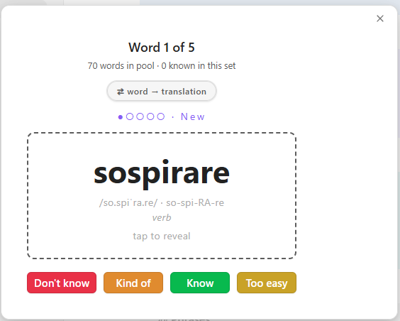
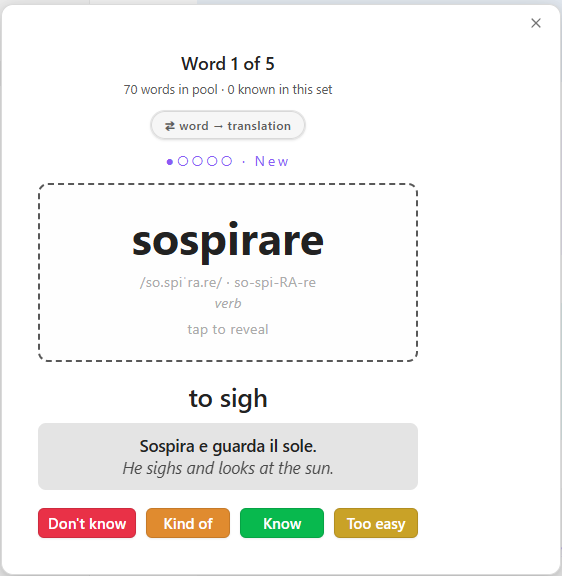
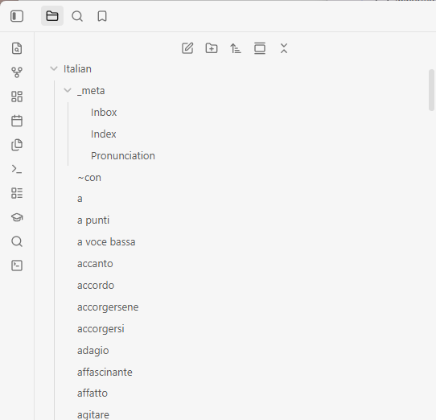
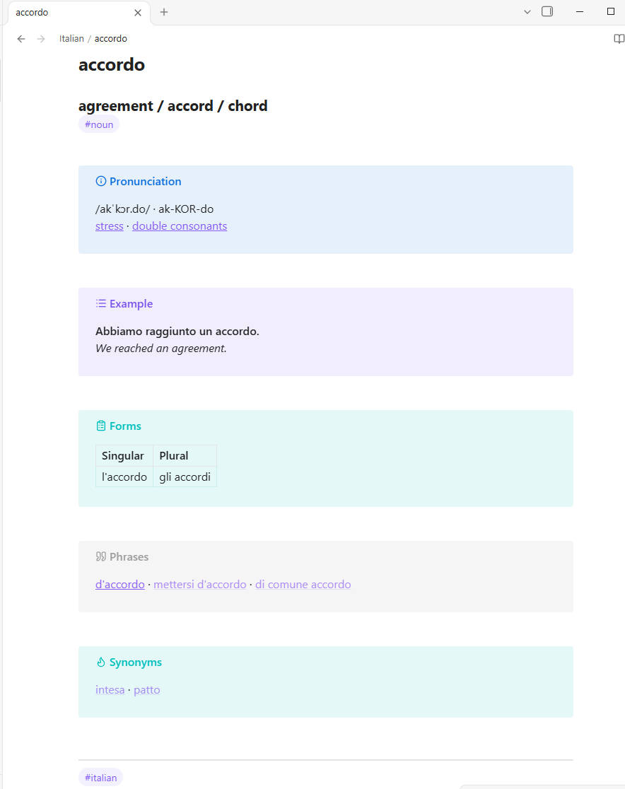

# Language Trainer Cards

Flashcard-style vocabulary trainer for Obsidian, for **any language**. It turns
your own markdown notes — one note per word — into a study deck with mastery
tracking, and works in both directions: forward (word → translation) and
reverse (translation → word), with independent progress for each.

## Screenshots

| Card front | Card flipped (answer + example) |
| --- | --- |
|  |  |

| Vocabulary folder in the vault | A word note |
| --- | --- |
|  |  |

## Features

- Flashcard-style learning interface
- Two directions with independent grading: forward (word → translation, recognition) and reverse (translation → word, recall)
- Mastery tracking with pools: New (0–2★), Learning (3–4★), Mastered (5★+), and an Archive
- Progress persistence across sessions and devices (stored in the vault)
- Cross-platform support (desktop and mobile)
- Keyboard shortcuts for efficient studying
- **Add vocabulary word** command that scaffolds a correctly-formatted word note
- Works with any language — just point it at a folder of word notes

## Installation

1. Copy `main.js`, `manifest.json`, and `styles.css` to your vault's
   `.obsidian/plugins/language-trainer-cards/` directory
2. Reload Obsidian
3. Enable the plugin in Settings → Community plugins
4. Set the vocabulary folder in the plugin settings (default: `Italian`)
5. Run the command **Open trainer — forward (word → translation)** or
   **Open trainer — reverse (translation → word)** to start

## Vocabulary folder

The plugin reads every markdown file in the configured folder as one word.
Files and folders whose names start with `_` are ignored, so you can keep
indexes and reference notes next to the words (e.g. `Italian/_meta/Index.md`).

### Optional: organizing with a `_meta` folder

A useful convention is a `_meta` folder inside the vocabulary folder:

- **`Inbox.md`** — a running dump of new words and phrases you encounter.
- **`Index.md`** — a generated list of all words for browsing and review. It
  lives under `_meta`, so it never becomes a flashcard.
- **`Pronunciation.md`** — your language's pronunciation rules (IPA and
  respelling conventions). Word pages can link to its sections, so each rule is
  explained once, in one place.

### A typical workflow with the Inbox

While reading or listening, dump **everything** new into `Inbox.md` as quick
bullets — words, phrases, even grammar questions. Later, ask your AI agent to
"process the inbox": with the [add-word skill](.claude/skills/add-word/SKILL.md)
installed, the agent turns each item into a properly formatted word page (new
words get pages, phrases with their own meaning get phrase pages, questions get
answered on the relevant page), keeps synonym/phrase links two-way, and clears
the processed items from the inbox. No agent? The **Add vocabulary word**
command and the template cover the same ground by hand.

## Creating words

Each word is a markdown note. Use the **Add vocabulary word** command to fill a
form and create the note, or write the file by hand (see
[`templates/word-template.md`](templates/word-template.md)).

If you use an AI agent to manage your notes, the repo also ships an
[add-word skill](.claude/skills/add-word/SKILL.md) that teaches the agent the
page layout and linking conventions.

The plugin reads these blocks from a note:

The full template ([`templates/word-template.md`](templates/word-template.md)):

```markdown
### <translation in your language>
#<part of speech: verb, noun, adjective, adverb, pronoun, …>


> [!info] Pronunciation
> /<IPA>/ · <RE-spel-ling>


> [!example] Example
> **<Sentence in the studied language.>**
> *<Sentence in your language.>*


> [!abstract]- Forms
> |  | <form 1> | <form 2> | <form 3> |
> | --- | --- | --- | --- |
> | <person/number/gender> |  |  |  |


> [!quote] Phrases
> [[<phrase containing this word>]]


> [!tip] Synonyms
> [[<word>]] · [[<word>]]


> [!note] Notes
> - <grammar, irregularities, usage notes>
```

What the card reads from it:

- **File name** (minus `.md`) → the word on the card.
- **`### ` line** → the translation shown on the back. Required for reverse mode.
- **Pronunciation** callout → `/IPA/ · Respelling` on one line (optional).
- **Example** callout → a bold sentence in the studied language, then an italic
  translation (optional; fold markers like `[!example]-` are fine).
- **Synonyms** callout → `[[wiki links]]` joined with ` · ` (optional; shown in
  reverse mode, where they act as alternative answers).
- **First `#tag` line** → part of speech hint (replace the `#<part of speech…>`
  placeholder with a real tag like `#verb` or `#noun`).

Everything else — Forms tables, Phrases links, Notes, any free text — is for
you; the card ignores it, so keep whatever you like in your word files.

## Usage

- Click the prompt word or press **Space** to flip the card.
- The grade buttons adapt to the pool being studied:
  - **New** (0–2★): Don't know (−1★), Kind of (+1★), Know (→3★), Too easy (→5★ mastered)
  - **Learning** (3–4★): Don't know, Kind of, Too easy
  - **Mastered** (5★): Keep / Skip, Don't know (back to Learning), Archive (hide everywhere)
  - **Archived**: Know (keep archived), Don't know (release back to New at 0★)
- Number keys **1–4** trigger the visible buttons; **K** = Know, **D** = Don't know where offered.
- Press **R** or the **⇄** button to switch direction; each direction has its own mastery progress.
- Press **N** on the completion screen to start a new set.
- Progress is saved automatically.

## Data Storage

Mastery data is stored in `language-trainer-progress.json` in your vault root,
so it syncs across devices via Obsidian Sync or other sync methods.

## License

MIT
